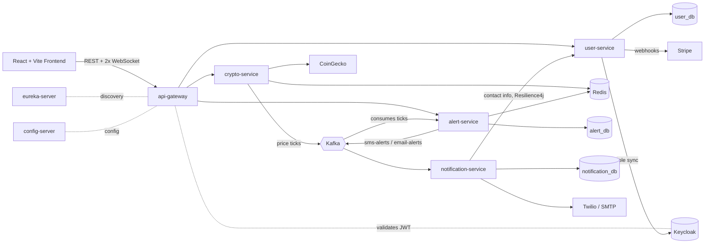

# BlocAlert

A **microservices-based crypto alerting platform** where users can:

* View the **top 250 cryptocurrencies** by market cap (via CoinGecko)
* See **real-time price updates** over WebSockets
* Create **price alerts** delivered in-app, by SMS, or by email
* Create alerts in **plain English** with an AI assistant (Spring AI)
* Get **5 free alerts**, with premium features unlocked via a **Stripe subscription**

BlocAlert started as a Spring Boot monolith and was deliberately migrated to a small set of
microservices. Every service boundary has a stated scaling or failure-isolation reason, and
the migration was done incrementally, one commit/PR per step. See
[Architecture decisions](#architecture-decisions) for the reasoning.

---

## Features

### Crypto Data & Real-Time Updates

* Polls the **top 250 coins** from CoinGecko (retry-protected) and caches them in Redis
* Real-time price stream via **WebSocket** (homepage table and coin detail views)
* Smooth UI updates with React + Vite + Tailwind

### Alerts System

* Create alerts based on price targets
* Notification channels:
  * **In-app** (WebSocket push)
  * **Email** (SMTP)
  * **SMS** (Twilio)
* **Free tier:** 5 active alerts per user
* **Premium tier:** unlimited alerts + SMS + Email via **Stripe subscription**
* Alert evaluation is **event-driven**: price ticks arrive over Kafka and are evaluated
  against Redis-cached thresholds

### AI-Assisted Alert Creation (Spring AI)

* Type something like *"notify me when BTC drops below $60k via SMS"*
* Spring AI (`ChatClient` + `BeanOutputConverter`) turns it into a structured alert request
* LLM output is treated as **untrusted input**: it is always re-validated through the normal
  alert validation (valid coin, sane threshold, channel allowed for the user's tier) before
  anything is created

### Authentication & Authorization

* **Keycloak** (self-hosted) is the identity provider: hosted login, self-registration,
  email verification, and password reset
* Services are **JWT resource servers**; the **API Gateway validates tokens at the edge**
* Role-based access (free / premium). Roles are synced into Keycloak on subscription changes,
  so they travel inside the JWT and services can authorize without calling each other
* A custom Keycloak **Event Listener SPI** notifies the backend on user registration
* Service-to-service calls use Keycloak **machine-to-machine (client credentials)** tokens

### Resilience

* **Resilience4j** circuit breakers and retries on synchronous cross-service calls and
  third-party calls, plus per-route circuit breakers with fallbacks at the gateway
* Kafka consumers use **Spring Cloud Stream retry with backoff and dead-letter topics**
  (the correct async equivalent of a circuit breaker)
* Stripe webhooks are **signature-verified** and **idempotent** (deduplicated on Stripe event ID)

---

## Architecture



### Business services

| Service | Responsibility | Data stores | Why it is its own service |
|---|---|---|---|
| **crypto-service** | Polls CoinGecko, serves market data, streams prices over WebSocket (`HomepageWebSocketHandler`, `CryptoDetailWebSocketHandler`), publishes price-tick events | Redis only (no MySQL) | Different scaling shape: I/O-bound, broadcast-heavy, many concurrent WebSocket connections, almost no writes. First candidate for horizontal scaling |
| **alert-service** | Alert CRUD and limits, alert evaluation on price ticks, in-app alert WebSocket, delivery event publishing, Spring AI assistant | MySQL (`alert_db`), Redis (cached thresholds) | Core domain with its own evaluation hot path; the AI assistant lives here as an `assistant/` package because it needs in-process access to alert validation |
| **notification-service** | Consumes `sms-alerts` / `email-alerts`, sends via Twilio and SMTP, logs deliveries, handles Twilio callbacks, message templates | MySQL (`notification_db`) | Different failure domain (Twilio/SMTP outages must not affect the core API) and a bursty, purely event-driven load |
| **user-service** | Users, Keycloak admin integration, Stripe subscriptions and webhooks, internal contact-info endpoint | MySQL (`user_db`) | Owns identity-linked data and billing. User and Subscription are intentionally **one** service: neither has independent scaling or isolation pressure |

### Platform services

| Component | Purpose |
|---|---|
| **api-gateway** | Spring Cloud Gateway: path routing, JWT validation at the edge, proxies both WebSocket endpoints (market stream and alert stream), per-route circuit breakers |
| **eureka-server** | Service discovery; all services and the gateway register here |
| **config-server** | Centralized, filesystem-backed config; services pull config on boot via `spring.config.import=configserver:` |
| **shared-events** | Not a running service: a plain Maven library with Kafka event payload classes only (no logic), built first in the reactor |

### Event flow

1. `crypto-service` polls CoinGecko, updates Redis, broadcasts to WebSocket clients, and publishes a
   plain **price-tick event** with no knowledge of alerts.
2. `alert-service` consumes the tick and evaluates thresholds against its Redis cache.
3. When a threshold is met, `alert-service` pushes an in-app WebSocket notification and publishes
   `sms-alerts` / `email-alerts` events (based on the user's tier).
4. `notification-service` consumes them, looks up contact info from `user-service`
   (Resilience4j-wrapped), sends via Twilio/SMTP, and logs the delivery.

### Subscription flow (Stripe)

1. User picks a premium plan and a Stripe Checkout session is created by `user-service`.
2. Stripe calls the webhook; the signature is verified and the event ID is checked for idempotency.
3. `user-service` upgrades the user in its DB and syncs the role to Keycloak in-process
   (no Kafka hop: both live in the same service).
4. The next JWT carries the premium role, so `alert-service` enforces limits with no direct
   call to `user-service`.

---

## Architecture decisions

**Guiding principle:** microservices solve organizational and operational problems
(independent scaling, fault isolation, independent deployment), not technical curiosity.
A new service is only added if one sentence can state the scaling or failure-isolation
pressure that justifies it; otherwise it stays as a clearly-bounded package.

Notable decisions:

* **Package-by-feature first.** The monolith was restructured from technical layers to
  feature packages (`alert/`, `crypto/`, `user/`, `subscription/`, `notification/`) before
  any extraction.
* **Synchronous coupling became events.** The monolith's `AlertNotificationPublisher`
  called `evaluateAlerts()` in-process via a `@Lazy` circular-dependency workaround. It is now a
  Kafka price-tick consumer in `alert-service`, which removed the workaround entirely.
* **User and Subscription are merged.** Stripe webhooks are low-frequency and neither side
  needs independent scaling, so they share one deployable. The Kafka events that only existed to
  cross that boundary were collapsed back into a direct in-process call.
* **User is not part of alert-service.** The alert limit check reads the role from the JWT and
  counts alerts in its own DB, so it never needs user data.
* **Role in the JWT instead of cross-service auth calls.** Keeps alert creation off the
  user-service hot path.
* **Spring AI stays inside alert-service**, not a separate service, because it needs
  in-process validation, and LLM output is never trusted or persisted directly.
* **Kafka via Spring Cloud Stream functional bindings** (`Supplier` / `Function` / `Consumer`)
  instead of raw `KafkaTemplate` / `@KafkaListener`.

---

## Tech Stack

### Frontend

* React (Vite), Tailwind CSS, Axios
* Keycloak JS adapter (OIDC)
* Sentry for error tracking
* Two WebSocket connections: market prices and alerts

### Backend

* Java 25, Spring Boot
* Spring Cloud: Gateway, Netflix Eureka, Config Server, Stream (Kafka binder)
* Spring Security (OAuth2 resource server), Spring Data JPA, Spring WebSocket
* **Spring AI** (natural-language alert creation)
* **Resilience4j** (circuit breaker, retry)
* **Keycloak** (identity provider, custom Event Listener SPI)
* Kafka, Redis, MySQL
* Stripe SDK, Twilio, SMTP (email)
* Guava RateLimiter

### DevOps / Observability

* Docker / Docker Compose (full stack with one command)
* **Prometheus** (metrics via Actuator, including Resilience4j Micrometer metrics)
* **Loki** (logs via Loki4j appender)
* **Grafana** (dashboards)
* **Grafana Alloy** (log collection and OTLP collector across services)
* **OpenTelemetry** distributed tracing, with context propagated over HTTP headers and
  Kafka message headers (gateway → services → Kafka → notification-service)
* Trace IDs are added to the logging MDC so logs and traces cross-reference
* Sentry (frontend)

---

## Application screenshots

> Add screenshots below (replace each placeholder with your uploaded image).


> ⚠️ **GIF not playing?**
> Click the image to open it in a new tab and view the full animation.


> ⚠️ **GIF not playing?**
> Click the image to open it in a new tab and view the full animation.


---

## Project Structure

```
BlocAlert/
├── shared-events/          # Kafka event payload classes (Maven library, not a service)
├── eureka-server/          # Service discovery
├── config-server/          # Centralized configuration
├── api-gateway/            # Spring Cloud Gateway (JWT validation, routing, WS proxy)
├── crypto-service/         # Market data + price WebSocket streams
├── alert-service/          # Alerts, evaluation, AI assistant (assistant/)
├── notification-service/   # SMS + email delivery
├── user-service/           # Users + subscriptions (Stripe) + Keycloak admin
├── keycloak/               # Realm export, theme, Event Listener SPI
├── observability/          # Prometheus, Loki, Grafana, Alloy configs
└── docker-compose.yml
```

---

## Environment Variables

Each service reads its config from `config-server` and its secrets from its own `.env`
file (loaded via `env_file:` in Compose).


---

## Local Development

### 1. Clone

```
git clone https://github.com/rafee-sp/BlocAlert.git
cd BlocAlert
```

### 2. Configure

Create the `.env` files described above (backend services and `frontend/`).

### 3. Run everything with Docker Compose

```
docker compose up --build
```

Run this from the repository root so all relative build contexts resolve. Compose starts
infrastructure (MySQL, Redis, Kafka, Keycloak), then `eureka-server` and `config-server`,
then the business services and gateway, then the frontend and the observability stack.

| Component | URL |
|---|---|
| Frontend | http://localhost:5173 |
| API Gateway | http://localhost:8080 |
| Eureka dashboard | http://localhost:8761 |
| Keycloak | http://localhost:8180 |
| Grafana | http://localhost:3000 |
| Prometheus | http://localhost:9090 |

> Ports above are defaults; adjust them to match your `docker-compose.yml`.

### 4. Run a single service (optional)

Build the shared library first, then start a service:

```
mvn -pl shared-events install
cd alert-service
./mvnw spring-boot:run
```

Start `eureka-server` and `config-server` before any business service.

---

## Migration History

The migration was done in deliberate, individually verified steps, each as its own commit/PR:

1. Package-by-feature restructure of the monolith
2. Dockerized the monolith and added the observability stack
3. Extracted `shared-events`
4. Added `eureka-server` and `config-server`
5. Extracted `crypto-service` (after turning the direct alert-evaluation call into a price-tick event)
6. Extracted `alert-service`
7. Extracted `notification-service`
8. Consolidated `user-service` (users + subscriptions)
9. Added `api-gateway` (JWT at the edge, both WebSocket proxies)
10. Added Resilience4j at cross-service and third-party call sites
11. Added Alloy and OpenTelemetry tracing
12. Migrated Auth0 → Keycloak with a custom Event Listener SPI
13. Added Spring AI natural-language alert creation
14. Full-stack Docker Compose, verified from a clean `docker compose up --build`
